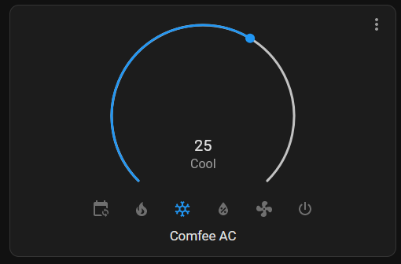

**2026 UPDATE**: ESPHome got support for these blasters. Here is my config, for the whole thing:

```yaml
# Board: Tuya Generic IRC03 IR Blaster
# Definition: definitions/boards/tuya_generic_irc03_ir_blaster/manifest.yaml

esphome:
  name: ir
  friendly_name: ir

bk72xx:
  board: generic-bk7231n-qfn32-tuya

logger:

captive_portal:

output:
  - platform: libretiny_pwm
    id: led
    pin: 24

light:
  - platform: monochromatic
    name: LED
    id: light_monochromatic_1
    output: led

binary_sensor:
  - platform: gpio
    name: btn
    id: btn
    pin:
      inverted: true
      mode:
        input: true
        pullup: true
      number: 9

remote_transmitter:
  pin: 7
  carrier_duty_percent: 50%

remote_receiver:
  pin:
    number: 8
    inverted: true
    mode:
      input: true
      pullup: true
  tolerance: 55%

climate:
- platform: coolix
  name: "AC"
```

Pretty easy, eh? Works great for me. Here is old article, for you if you want to go through AppDaemon and my horrible 3-year old code I hacked together.

# I want to suffer, give me AppDaemon code

A lot of new cheap chinese IoT-thingies come with custom Tuya ESP pin-compatible boards, which are incompatible with ESPHome or Tasmota, but compatible with [OpenBeken](https://github.com/openshwprojects/OpenBK7231T_App).

However, OpenBeken is still in kinda-early stages of development and IR support on official builds is a bit limited. So you would need to use a version from pull request that implements much more IR features, including the ability to send COOLIX commands, without friendly interface, sadly.

<!--more-->

So I made a appdaemon mqtt app that creates COOLIX codes and sends them to OpenBK7231T.

First you would need to install the fork. Just grab [latest build](https://github.com/openshwprojects/OpenBK7231T_App/pull/723) in action check section for your version of BK7231-thing and install it. After that, check if your AC issues actually uses COOLIX commands - go to your OpenBeken web interface, go to webapp and open log page. My AC remote for some reason didn't emit any IR other than poweroff, which was recognized as `Unknown` command. However, [Mi Remote](https://play.google.com/store/apps/details?id=com.duokan.phone.remotecontroller&hl=en&gl=US) app managed to control AC and issued COOLIX commands.

Here is an app script:



Set the variables:

- `UID`: HomeAssistant UID for entity
- `MY_NS`: topic under which app will publish your AC
- `IR_BLASTER`: mqtt topic for your IR blaster commands
- `DEVICE_NAME`: name, under which your AC will appear

And after installing the appdaemon app, should automatically appear in your HomeAssistant through MQTT auto-discovery!


